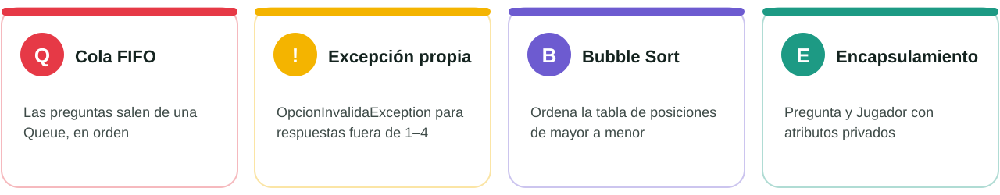
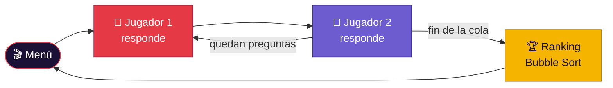

<div align="center">


<a href="https://claude.ai/artifact/6RK7nyF9HsXZztpKUsCuZy"></a>

</div>



### 🎞️ Una partida



## 🍿 Qué es

Un juego de preguntas de **cine y series** que se juega en la terminal. Dos jugadores se turnan para responder, cada acierto suma puntos según la dificultad y al final se arma una **tabla de posiciones** ordenada de mayor a menor puntaje.


## 🎮 Cómo se juega

1. Elegí **Iniciar partida** en el menú principal.
2. Cada jugador responde por turnos con un número del **1 al 4**.
3. Las preguntas más difíciles valen más puntos.
4. Al terminar, mirá el **ranking** desde el menú.

```text
1. Iniciar Partida de 2 Jugadores (Por Turnos)
2. Ver Tabla de Posiciones (Ranking)
3. Ver Instrucciones y Reglas
4. Salir
```


## ▶️ Cómo ejecutarlo

Hace falta tener instalado el **JDK** (Java 8 o superior).

```bash
javac *.java
java JuegoTriviaCineSeries
```


## 🧩 Qué se aplicó (Programación)

| Concepto | Dónde |
|---|---|
| **Encapsulamiento** (atributos privados, getters) | `Pregunta`, `Jugador` |
| **Cola FIFO** (`Queue<Pregunta>`) para el flujo de preguntas | `JuegoTriviaCineSeries` |
| **Lista dinámica** (`ArrayList<Jugador>`) para el ranking | `JuegoTriviaCineSeries` |
| **Excepción personalizada** para opciones fuera de rango | `OpcionInvalidaException` |
| **Bubble Sort** para ordenar la tabla de posiciones | `JuegoTriviaCineSeries` |
| **Menú interactivo** con `Scanner` y control de entradas inválidas | `JuegoTriviaCineSeries` |


## 📁 Archivos

| Archivo | Para qué |
|---|---|
| `JuegoTriviaCineSeries.java` | Programa principal: menú, banco de preguntas, partida y ranking |
| `Pregunta.java` | Una pregunta con sus opciones, respuesta correcta, puntos y categoría |
| `Jugador.java` | Nombre, puntaje, aciertos y errores de cada jugador |
| `OpcionInvalidaException.java` | Error propio cuando la opción no está entre 1 y 4 |


<div align="center"><sub>Trabajo de la facultad · Universidad Politécnica y Artística del Paraguay (UPA)</sub></div>
